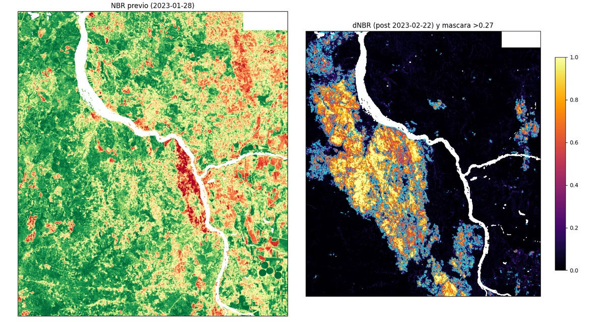
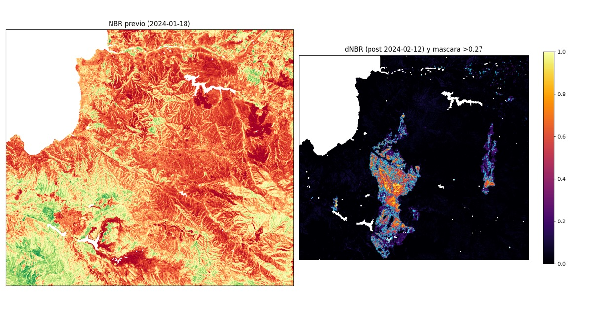

# Informe: Validación retrospectiva real de incendios (Santa Juana 2023 · Viña del Mar 2024)

**Estado del informe:** datos observados y clima real incorporados · **motor de propagación todavía NO ejecutado** · **sin resultados de validación**.
Este documento separa lo que está medido de lo que aún no se ha hecho.

---

## 1. Corrección de lo publicado antes

La pestaña *5. Auditoría Retrospectiva* del Vault y [`CALIBRACION_SENSIBILIDAD_UQ_VALIDACION.md`](CALIBRACION_SENSIBILIDAD_UQ_VALIDACION.md) muestran un IoU de 74,3 % y un score de 90,5 %. Esos números **no provienen de comparar una simulación con un perímetro real**:

- En `scripts/benchmark/benchmark_suite.py` las superficies (real 348,5 ha, simulada 362 ha, traslape 302,8 ha) están escritas como constantes. El IoU es una fórmula sobre esas constantes.
- El "polígono CONAF" y la "elipse" del Modo B son un SVG dibujado a mano, sin coordenadas geográficas.
- El simulador del mapa (`geo-layers.js`, *Click-to-Ignite*) usa velocidad fija (`18,4 m/min × multiplicador del régimen`) y porcentajes de ruptura de faja fijos por régimen. No depende de fecha, relieve ni combustible.

Esas cifras deben leerse como **ilustrativas** hasta que exista la validación descrita aquí.

## 2. Qué se hizo (reproducible)

Todo vive en `scripts/hindcast/` y se ejecuta con un entorno aislado (`requirements.txt`).

| Paso | Script | Qué hace |
|---|---|---|
| 1 | `01_fetch_inputs.py` | Clima horario ERA5 (Open-Meteo), lluvia de los 90 días previos y selección automática de escenas Sentinel-2 L2A (misma órbita, cobertura ≥ 85 % del área, baja nubosidad) |
| 2 | `02_burn_scar.py` | Cicatriz observada por **dNBR** (NBR previo − NBR posterior, umbral > 0,27 USGS), mosaico de tiles a 20 m, enmascarando nubes, sombras y agua |
| 3 | `03_export_sites.py` | Exporta polígonos simplificados a `data/hindcast_sites.json` para el mapa de Cuenca |

## 3. Eventos

### 3.1 Santa Juana, Biobío · febrero 2023



| Dato | Valor |
|---|---|
| Escenas Sentinel-2 | pre 28-ene-2023 · post 22-feb-2023 (órbita 96) |
| Cobertura útil del área de estudio | 96,7 % |
| **Mancha principal observada** | **42.599 ha** (57.221 ha en total dentro del área de estudio) |
| Forma | alargada NO–SE, junto al río Biobío |
| Clima ERA5, 2–4 feb | T máx **40,0 °C** · HR mín **11 %** · ráfaga máx **58 km/h**, desde el SE (143–159°) |
| Giro de viento | el 4-feb ~12 UTC pasa al NO (≈305°) y la HR sube a 81 % |
| Lluvia 90 días previos | **96,8 mm** (11 días con > 1 mm) |

La orientación de la mancha es coherente con el viento del SE (empuja hacia el NO).

### 3.2 Viña del Mar / Quilpué / Villa Alemana, Valparaíso · febrero 2024



| Dato | Valor |
|---|---|
| Escenas Sentinel-2 | pre 18-ene-2024 · post 12-feb-2024 (órbita 96) |
| Cobertura útil del área de estudio | 87,6 % |
| **Mancha principal observada** | **2.989 ha** (5.707 ha en total dentro del área de estudio) |
| Forma | alargada N–S, con una mancha secundaria hacia el este |
| Clima ERA5, 2–4 feb | T máx **34,4 °C** · HR mín **21 %** · ráfaga máx **65 km/h**, desde el S–SSO (≈180–206°) |
| Lluvia 90 días previos | **30,6 mm** |

El viento del sur calza con una mancha que se extiende hacia el norte. La lluvia previa es unas tres veces menor que en Santa Juana, coherente con el contexto de sequía de la zona central; todavía no la comparé con la climatología.

## 4. Límites que hay que declarar

1. **La mancha no es un solo incendio.** El dNBR integra todo lo quemado entre la escena previa y la posterior. Santa Juana reúne varios focos y días; separar por día exige FIRMS.
2. **No es el perímetro oficial CONAF.** Es un perímetro derivado de satélite, con 20 m de resolución y umbral fijo.
3. **Viña está subestimada.** Las viviendas quemadas cambian poco el NBR y el área de estudio recorta parte de la zona; las cifras oficiales del evento son mayores. No se usó ninguna cifra oficial como verdad en este informe.
4. **ERA5 tiene ≈ 9 km de resolución.** Suaviza el viento de ladera y la brisa costera; es un límite del método.
5. **Escena previa de Viña.** El 18-ene es 15 días antes del evento; puede haber cambios de fenología.
6. **El área mide quemado, no propagación.** No da la hora de avance del frente.

## 5. Qué falta (en este orden)

1. **NASA FIRMS (VIIRS 375 m):** primera detección como ignición real y progresión por pasada. Requiere `FIRMS_MAP_KEY` (gratuita).
2. **Motor:** Rothermel + elipse de Fons con relieve Copernicus 30 m, combustible por cobertura y el viento ERA5 hora a hora.
3. **Protocolo anti-sobreajuste:** calibrar en un evento y medir en el otro (y viceversa). El IoU que se reporte será el del evento **no usado** para calibrar.
4. Reemplazar las cifras fijas del Vault por las medidas y marcar lo ilustrativo como tal.

## 6. Los dos sitios en el mapa de Cuenca

Las manchas aparecen como capa **🔥 Sitios de validación (Santa Juana · Viña) — solo cuenca** en el mapa de Cuenca. No son predios con gemelo digital, no abren vista predial y no entran en los conteos de la red vecinal. Cada popup indica la fuente del área y que el sitio está **no validado**.

## 7. Reproducir

```bash
cd scripts/hindcast
python3 -m venv .venv && .venv/bin/pip install -r requirements.txt
for k in santa_juana_2023 vina_2024; do
  .venv/bin/python 01_fetch_inputs.py $k && .venv/bin/python 02_burn_scar.py $k
done
.venv/bin/python 03_export_sites.py
```
