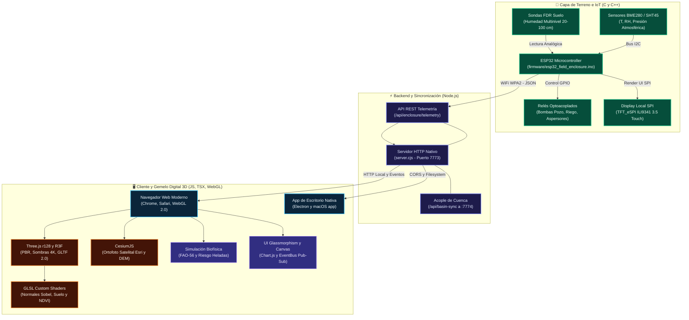
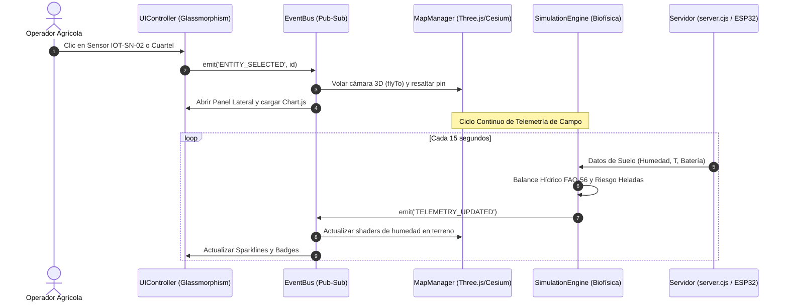

# 🛠️ [[STACK_TECNOLOGICO_ARQUITECTURA_AGRITWIN|Stack Tecnológico, Lenguajes y Arquitectura de AgriTwin]]

> **Definición de Sistema**: [[Agritwin]] (Rama 1: *Predio Twin* de la suite [[AGROTECH]]) es una plataforma de gemelo digital agrícola biofísico de alta resolución. Su arquitectura es **full-stack, desacoplada y orientada a eventos**, integrando desde el silicio de microcontroladores de campo en C++ hasta renderizado fotorealista acelerado por GPU en el navegador mediante WebGL/GLSL y wrappers nativos de escritorio.

---

## 🧭 1. Diagrama de Arquitectura Global del Sistema

Flujo integral de datos entre el hardware de terreno, la capa de sincronización en servidor y los motores gráficos de cliente:

---

## 💻 2. Lenguajes de Programación por Subsistema

| Subsistema / Módulo | Lenguaje Principal | Archivos de Referencia | Rol en AgriTwin |
| :--- | :--- | :--- | :--- |
| **Lógica de Cliente & UI** | **JavaScript (ES6+ / ESM)** | `js/app.js`, `js/ui/*.js`, `index.html` | Orquestación, manejo del DOM, EventBus reactivo, panel Glassmorphism y controles. |
| **Renderizado Gráfico 3D** | **GLSL** (OpenGL Shading Language) | `js/map/BiophysicalTerrainShader.js` | Shaders de cálculo de normales Sobel procedurales, absorción lumínica en suelo y gradientes NDVI. |
| **Componentes React 3D** | **JSX / JavaScript** | `js/r3f/*.jsx` | Composición declarativa de mallas botánicas, atmósfera solar y nodos de sensores instanciados. |
| **Servidor & APIs Locales** | **JavaScript (Node.js CommonJS)** | `server.cjs`, `test-ecosystem-sync.cjs` | Despacho ultraligero sin dependencias externas, acople de cuenca (:7774) y endpoints de actuadores. |
| **Firmware Embebido IoT** | **C / C++ (Arduino Framework)** | `firmware/esp32_field_enclosure.ino` | Adquisición física analógica/I2C, visualización en display SPI TFT y disparo de relés industriales. |
| **Shell & Empaque macOS** | **Swift** & **Bash / Shell** | `set_icon.swift`, `launch-desktop.command` | Compilación de scripts nativos para asignación de iconos del Finder y lanzador de escritorio. |
| **Visor Desktop Integrado** | **TypeScript / TSX** | `desktop/AgroTwinDynamicViewer.tsx` | Contrato de tipado estricto para clientes desacoplados en suites mayores. |

---

## ⚙️ 3. Diagrama de Módulos y Flujo de Eventos (Frontend)

El cliente utiliza un patrón desacoplado **Pub/Sub** a través de `EventBus.js` que sincroniza el motor 3D con la telemetría biofísica:

---

## 📦 4. Mapa Estructurado del Ecosistema de Tecnologías

Estructura jerárquica de tecnologías, motores y estándares utilizados en el proyecto:

```mermaid
graph TD
    classDef root fill:#0B2519,stroke:#10B981,stroke-width:3px,color:#FFF;
    classDef branch fill:#071810,stroke:#F59E0B,stroke-width:2px,color:#FFF;
    classDef leaf fill:#1E293B,stroke:#64748B,stroke-width:1px,color:#FFF;

    ROOT["AgriTwin 3D Suite<br/>(Gemelo Digital Predial)"]:::root

    ROOT --> M3D["Motores 3D y Shaders"]:::branch
    ROOT --> DAT["Datos y Geoespacial"]:::branch
    ROOT --> GUI["Interfaz y UX"]:::branch
    ROOT --> IOT["Hardware IoT en Terreno"]:::branch
    ROOT --> SIS["Sistemas y Runtime"]:::branch

    M3D --> T1["Three.js r128 (WebGL 2.0)"]:::leaf
    M3D --> T2["CesiumJS (Ortofoto Esri Abierta)"]:::leaf
    M3D --> T3["React Three Fiber (R3F)"]:::leaf
    M3D --> T4["Shaders GLSL (Texturas Sobel PBR)"]:::leaf

    DAT --> D1["Modelos 3D GLTF y GLB 2.0"]:::leaf
    DAT --> D2["Polígonos GeoJSON WGS84"]:::leaf
    DAT --> D3["Shapefiles (.shp) con shpjs"]:::leaf
    DAT --> D4["Ecosistema Maestro JSON"]:::leaf

    GUI --> G1["Glassmorphism (Backdrop-filter CSS)"]:::leaf
    GUI --> G2["Chart.js y Canvas 2D"]:::leaf
    GUI --> G3["Tipografías Inter y Outfit"]:::leaf
    GUI --> G4["EventBus Desacoplado Pub-Sub"]:::leaf

    IOT --> I1["Microcontrolador ESP32 DevKit/S3"]:::leaf
    IOT --> I2["C y C++ (Arduino Core)"]:::leaf
    IOT --> I3["Display TFT SPI ILI9341"]:::leaf
    IOT --> I4["Sondas FDR y Relés Industriales"]:::leaf

    SIS --> S1["Node.js Nativo (server.cjs :7773)"]:::leaf
    SIS --> S2["Puente de Cuenca (:7774)"]:::leaf
    SIS --> S3["Electron Desktop Wrapper"]:::leaf
    SIS --> S4["Binarios Swift y Scripts Bash"]:::leaf
```

---

### Detalle de Tecnologías:

1. **Motores de Renderizado Visual:**
   * **Three.js (r128)**: Renderizado de alta fidelidad, iluminación fotométrica con sol astronómico a latitud `-36.14°S`, sombras `PCFSoftShadowMap` a 4096×4096 y carga de modelos glTF/GLB.
   * **CesiumJS**: Capa de georeferencia satelital planetaria con ortofotos abiertas de Esri World Imagery (sin costo de API Key).
   * **React Three Fiber (R3F)**: Abstracción de escena modular en `js/r3f/` para pipelines PBR avanzados.

2. **Frontend UI & Gráficos:**
   * **Chart.js & Canvas 2D**: Gráficos de series de tiempo para humedad volumétrica de suelo a múltiples profundidades (20, 40, 60 y 100 cm).
   * **Efectos CSS Glassmorphism**: `backdrop-filter: blur(16px)` y paleta Obsidian Dark optimizada para trabajo en cabina o tablet agrícola.

3. **Backend y Servicios de Red:**
   * **Node.js (`server.cjs`)**: Servidor cero dependencias (`npm-free`) para despliegue instantáneo en computadores locales de campo o servidores industriales de predio. Expone `/api/enclosure/*` y el puente de cuenca `/api/basin-sync`.
   * **APIs Externas**: Integración REST con Open-Meteo y OpenWeatherMap para pronósticos de microclima y heladas con 72 horas de horizonte.

4. **Hardware y Gabinete IP67:**
   * **C++ (Arduino Core)**: Firmware compilable para microcontroladores ESP32 con manejo de interrupciones, bus SPI para pantallas y control de relés de conmutación de bombas de pozo profundo DGA.

---

*Vínculos del Vault*: [[Agritwin]] • [[ARQUITECTURA_VISUAL_MOTOR_3D_PBR]] • [[AGROTECH]] • [[Sensores y Hardware KioT]] • [[KioT Hardware]] • [[FAO-56 Penman-Monteith]]
